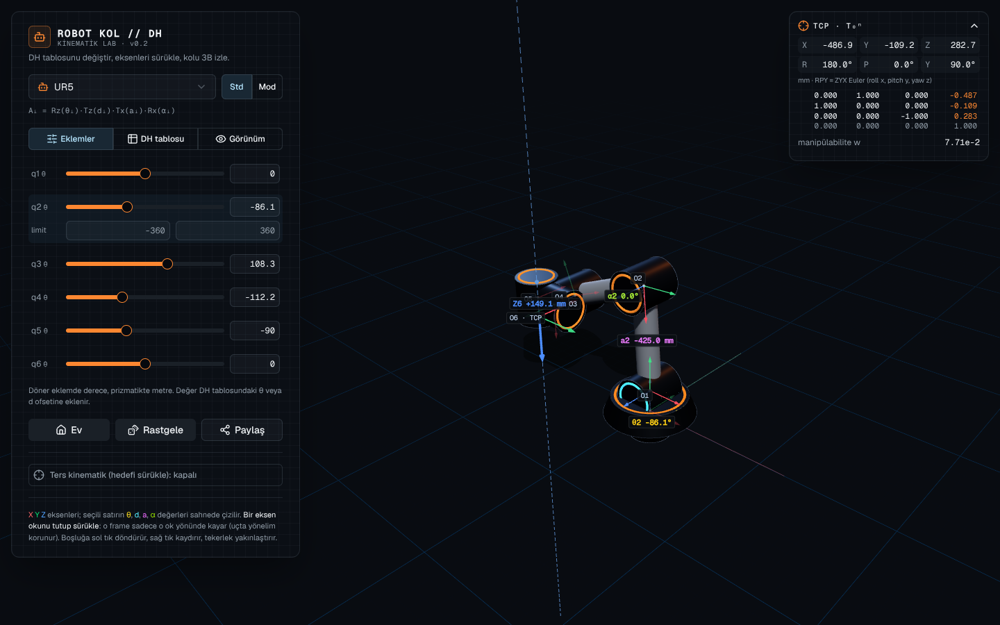
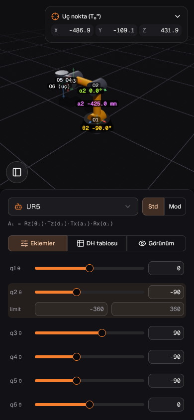
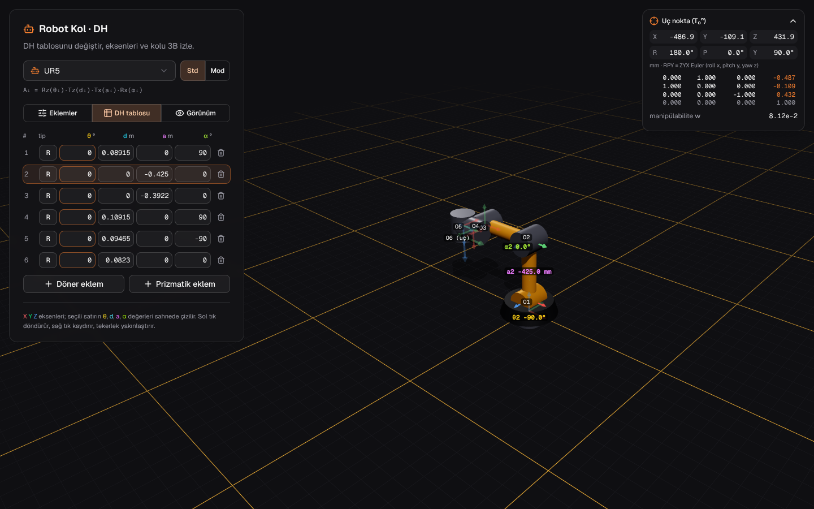
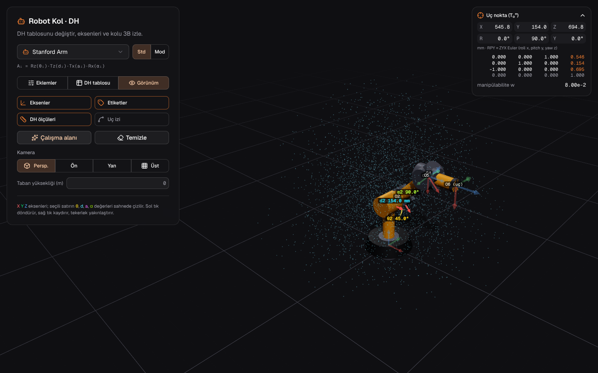

# r3f-robotarm

React Three Fiber + shadcn/ui ile 3B robot kol laboratuvarı: DH tablosunu değiştir, her eklemin koordinat eksenlerini ve θ, d, a, α değerlerini sahnede gör, endüstriyel robotu ileri ve ters kinematikle oynat.

## ▶ Demo

**https://billylz.github.io/r3f-robotarm/**

<p>
  
  
</p>

## Özellikler

- **DH tablosu düzenleyici**: satır ekle/sil, her eklem döner (**R**) ya da prizmatik (**P**), θ d a α hücreleri canlı.
- **Standart / Modified (Craig) DH** geçişi:
  - Standart: `Aᵢ = Rz(θᵢ)·Tz(dᵢ)·Tx(aᵢ)·Rx(αᵢ)`
  - Modified: `Aᵢ = Rx(αᵢ₋₁)·Tx(aᵢ₋₁)·Rz(θᵢ)·Tz(dᵢ)`
- **Eksenler**: her frame'de ince RGB = XYZ okları ve `O0 … On` etiketleri; seçili eklemin iki frame'i öne çıkar, diğerleri soluklaşır.
- **Eksenden tut, sürükle**: herhangi bir frame'in X, Y veya Z okunu tut; fare nereye giderse gitsin frame sadece o okun doğrultusunda kayar (ok üzerinde kesikli kılavuz çizgi ve mm cinsinden yol). Önceki eklemler ters kinematikle ayarlanır; 6 eksenli kolun ucunda (TCP) yönelim korunur, yani uç dönmeden düz kayar.
- **DH ölçüleri sahnede**: seçili satırın θ yayı (sarı), d uzunluğu (camgöbeği), a uzunluğu (pembe) ve α yayı (yeşil), tam etki ettikleri yerde çizilir.
- **Eklem sliderları**: döner eklemde derece, prizmatikte metre; eklem değeri tablodaki θ veya d ofsetine eklenir. Seçili eklemin limitleri düzenlenebilir.
- **Ters kinematik**: kırmızı hedefi sürükle (taşı / döndür), kol Damped Least Squares ile takip eder. 6 eksende hem konum hem yönelim, daha azında yalnız konum.
- **Uç nokta paneli**: T₀ⁿ matrisi, XYZ (mm), RPY (ZYX Euler) ve Yoshikawa manipülabilitesi `√det(J·Jᵀ)`; tekilliğe yaklaşınca uyarır.
- **Çalışma alanı**: limitler içinde 5000 rastgele eklem açısıyla ulaşılan noktalar bulut olarak çizilir. **Uç izi** ucun gittiği yolu çizer.
- **Hazır robotlar**: UR5, ABB IRB 120, PUMA 560 (standart ve Craig tablosu), Stanford Arm, SCARA, 2R düzlemsel.
- **Paylaş**: robot ve duruşu link olarak paylaşılır.

<p>
  
  
</p>

## Robot linki

Robot, adresin `#` işaretinden sonrasına yazılır:

```
#std:R,0,0.4,0.35,0;R,0,0,0.3,180;P,0,0,0,0,0,0.3;R,0,0.05,0,0@30,60,0.1,0
```

- `std:` veya `mdh:` standart ya da modified DH (yazılmazsa `std`).
- Satırlar `;` ile ayrılır, her satır `tip,θ,d,a,α[,min,max]` (derece ve metre; tip `R` veya `P`).
- `@` sonrası eklem değerleri, virgülle (isteğe bağlı).
- Başa `+0.66` gibi bir sayı yazılırsa taban yerden o kadar yükselir (isteğe bağlı).

## Geliştirme

```bash
npm install
npm run dev          # http://localhost:5173
npm test             # kinematik testleri (node --test)
npm run build        # dist/
npm run build:single # dist-single/index.html, tek dosya
```

Kinematik kodu (`src/kinematics/`) three.js'e bağlı olmayan saf JavaScript'tir; testler UR5, PUMA 560 ve IRB 120'nin bilinen uç noktalarını, IK'nın hedefe ulaşmasını ve tekillikte manipülabilitenin sıfıra düşmesini kontrol eder.

| Dosya | İçerik |
| --- | --- |
| `src/kinematics/dh.js` | DH link matrisi (standart / modified), ileri kinematik |
| `src/kinematics/ik.js` | Jacobian, manipülabilite, DLS ters kinematik |
| `src/kinematics/presets.js` | Hazır robotların DH tabloları |
| `src/dhcode.js` | Robot ↔ link metni |
| `src/components/Robot.jsx` | Kol, eklemler, eksenler, DH ölçüleri |
| `src/components/Scene.jsx` | Işık, zemin, kamera, IK hedefi, çalışma alanı |

## GitHub Pages

`.github/workflows/pages.yml` her push'ta test edip `dist/`'i yayınlar. İlk seferde repo ayarlarında **Settings → Pages → Source: GitHub Actions** seçilmeli.
